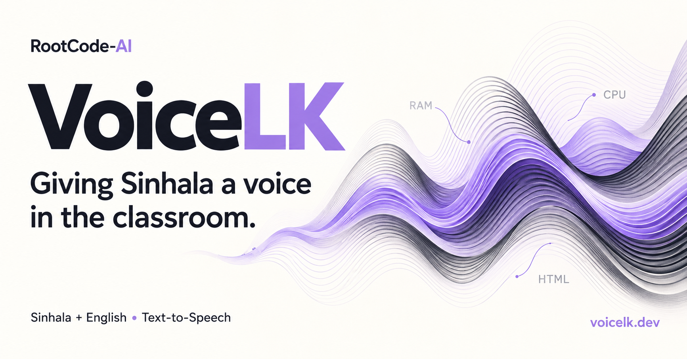
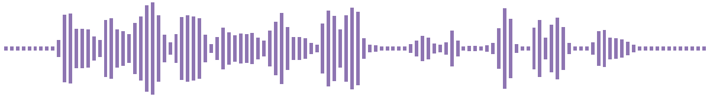

# RootCode-AI

**Giving Sinhala a voice in the classroom.**

We are a student research team building **VoiceLK** — a Sinhala/English code-switched text-to-speech system and the learning platform around it, made for Sri Lanka's G.C.E. O/L ICT students.

---

## 🎯 The problem

ICT lessons in Sri Lanka are taught in Sinhala, but the subject is full of English terms — *RAM*, *CPU*, *HTML*, *e-mail*. Off-the-shelf speech engines either cannot speak Sinhala or stumble the moment a sentence switches language. VoiceLK is built to read that mixed classroom language naturally, so students can listen to explanations instead of only reading them.

## 💡 How VoiceLK works

A student types or pastes an ICT topic. The backend asks Google Gemini for a Sinhala explanation, then sends the text to our speech service, which normalises it, converts it to phonemes with a code-switched pronunciation engine, and renders the audio with our own trained VITS model. The clip is stored and played back right in the chat.

> **Browser** → **Spring Boot backend** → **TTS Bridge** → **VITS model**
> The backend also talks to Supabase (database and audio storage), Gemini and Firebase; the bridge carries the text front-end — normaliser and grapheme-to-phoneme engine.

The speech service only turns text into audio and holds no secrets, so it can move to a GPU machine without touching the rest of the system. Every generated clip records the exact checkpoint that produced it, so any audio can be traced back to its weights.

---

## 🎧 Hear VoiceLK

These clips were rendered by **Speaker 02 V2.1**, our next single-speaker release, straight from the sentences below. Nothing was edited afterwards. Select a waveform to open its clip.

| Listen | Sentence | What it shows |
| --- | --- | --- |
|  | RAM එක කියන්නේ computer එකේ තාවකාලික මතකයයි. | An English acronym and an English word inside a Sinhala sentence |
|  | CPU එක පරිගණකයේ මොළය ලෙස හඳුන්වනවා. | Acronyms spelt out letter by letter, the way a teacher says them |
|  | HTML භාවිතා කරලා අපිට web page එකක් හදන්න පුළුවන්. | Switching language several times in one sentence |
|  | 1 GB එකක MB 1024ක් තියෙනවා. | Digits and units expanded into spoken words |
|  | ඔබේ e-mail ගිණුම ශක්තිමත් password එකකින් ආරක්ෂා කරගන්න. | Hyphenated terms and everyday ICT vocabulary |

22.05 kHz mono WAV, about 3 seconds each. Speaker 02 V2.1 is not live in the app yet; the voices you can use today are listed in the app's voice picker.

---

## 📦 Repositories

| Repository | What it is | Stack |
| --- | --- | --- |
| [**voicelk_ml**](https://github.com/RootCode-AI/voicelk_ml) | Research code — Sinhala/English text normalisation, code-switched G2P with an ICT lexicon, dataset preparation, VITS training, synthesis and evaluation | Python · PyTorch · Coqui TTS (vendored) |
| [**voicelk_bridge**](https://github.com/RootCode-AI/voicelk_bridge) | TTS microservice — serves the trained models over HTTP; self-contained and deployable with Docker or systemd | Python · FastAPI · PyTorch |
| [**voicelk_be**](https://github.com/RootCode-AI/voicelk_be) | Application backend — authentication, questions and answers, Gemini orchestration, voice catalogue, audio storage and records, speech endpoints | Java 25 · Spring Boot 4.1 · Supabase |
| [**voicelk_fe**](https://github.com/RootCode-AI/voicelk_fe) | Web client — chat-style topic input, voice picker, audio playback, history, profile, guest mode and help centre; live at [chat.voicelk.dev](https://chat.voicelk.dev) | React 19 · Vite · Tailwind CSS |
| [**voicelk_blog**](https://github.com/RootCode-AI/voicelk_blog) | Source of our project blog at [voicelk.dev](https://voicelk.dev) | — |

Every part of VoiceLK is open source, from the research pipeline to the speech service, the application and the blog, so the whole system can be read and examined end to end. The research code, the speech service, the backend and the web client are released under the MIT License; the Coqui TTS and trainer sources vendored into the research code and the speech service keep their own licenses, listed in those repositories' third-party notices.

## 🔬 Research highlights

- **One text front-end.** Normalisation and pronunciation are written once in the research repository and used for dataset preparation, training, evaluation and serving. The bridge carries a synced, fingerprinted copy, so a stale front-end shows up in its health check instead of quietly mispronouncing words.
- **Code-switching first.** Numbers, symbols, acronyms and English ICT vocabulary are expanded and pronounced the way a Sri Lankan teacher would say them, mid-sentence.
- **Versioned voices.** A multi-speaker model trained on the Pathnirwana corpus (Speaker 03) and our own single-speaker model, Speaker 02, whose releases are served side by side — V1.0, the new V2.0, and V2.1 coming soon. Each is selectable per request with speaker and speaking-rate controls, and older voices are retired openly rather than swapped out silently.
- **Presentable by design.** Core libraries such as Coqui TTS and its trainer are vendored as real source, so every part of the pipeline can be read and examined.

---

## 🛠️ Tech we use

---

## 🤝 Contributing

Issues and pull requests are welcome on every repository. Each one carries its own code of conduct and security policy — read them first, and report security problems privately as they describe rather than in a public issue.

Open your issue where the problem lives:

| If… | Open it on |
| --- | --- |
| VoiceLK says a word wrongly | [**voicelk_ml**](https://github.com/RootCode-AI/voicelk_ml/issues) — the text front-end that decides how words are read lives there; include the sentence and what you expected to hear |
| Audio fails to generate, or a voice will not load | [**voicelk_bridge**](https://github.com/RootCode-AI/voicelk_bridge/issues) |
| Sign-in, answers or saved audio misbehave | [**voicelk_be**](https://github.com/RootCode-AI/voicelk_be/issues) |
| Something looks or works wrong in the app | [**voicelk_fe**](https://github.com/RootCode-AI/voicelk_fe/issues) |
| A blog post has a mistake | [**voicelk_blog**](https://github.com/RootCode-AI/voicelk_blog/issues) |

The bridge carries a generated copy of the text front-end, so pronunciation fixes always go to **voicelk_ml** first and reach the speech service from there.

## 📬 Get in touch

- App: [chat.voicelk.dev](https://chat.voicelk.dev) — try VoiceLK in your browser
- Blog: [voicelk.dev](https://voicelk.dev) — follow our research notes and project updates
- Email: [rootcode2026@gmail.com](mailto:rootcode2026@gmail.com)

<!-- TODO: add X/Twitter, LinkedIn, etc. once available -->

---

VoiceLK is an academic research project. This is our GitHub organization profile — it's shown on [github.com/RootCode-AI](https://github.com/RootCode-AI).
